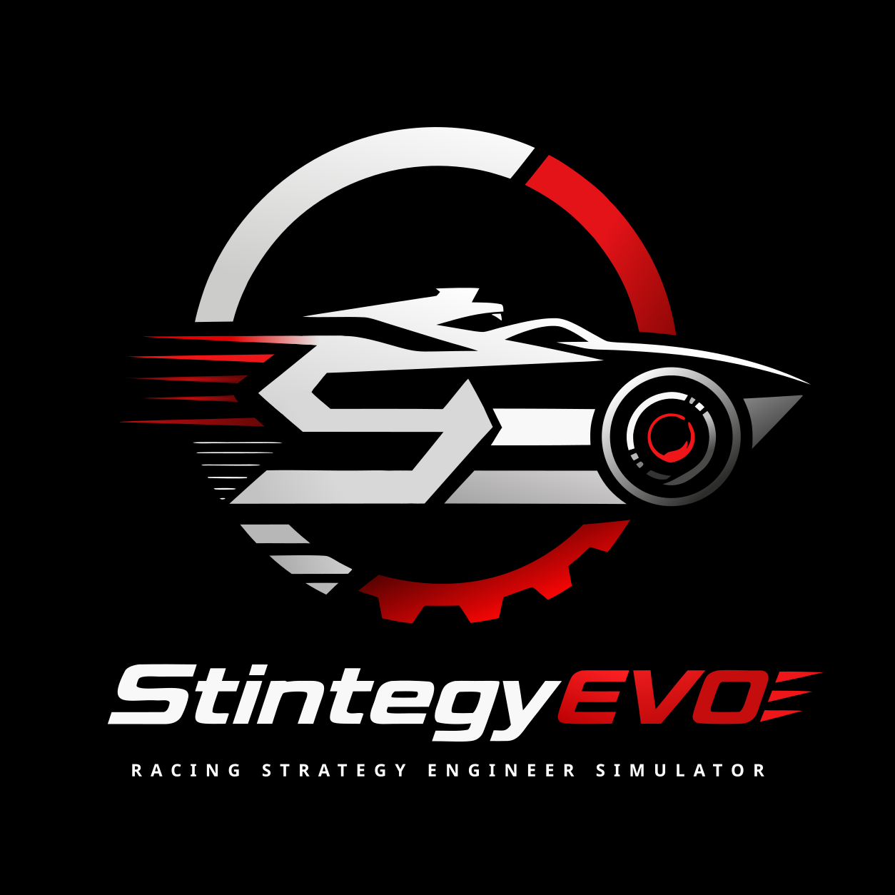

<p align="center">
  
</p>

# StintegyEVO — Racing Simulation Core

[中文正式版](README_zh.md)

StintegyEVO is a real-time racing simulation: vehicle and tyre physics, energy and wear, tracks, race stepping, and a Godot presentation layer. It ships the world, not the drivers. Anything that decides how a car is driven, whether rule-based, learned or human, plugs in from outside through one small interface.

**Open source, not community-driven.** The code is public under the AGPL and you are welcome to read, run, fork and build on it. The project is developed by its maintainer on their own schedule; issues and pull requests may be read, but there is no promise that they will be answered, reviewed or merged.

> We do not compete on who drives faster. We compete on who calculates better, while keeping the world model honest.

## Quick start: a car that moves

You need the [.NET 8 SDK](https://dotnet.microsoft.com/download). For the 3D view you also need [Godot 4.7 .NET](https://godotengine.org/download).

```bash
git clone https://github.com/MoYuSOwO/stintegy-evo.git
```

```bash
cd stintegy-evo && dotnet test Core/Tests/StintegyEVO.Core.Tests.csproj -c Release
```

The world never drives itself. To see a car go round, give it a controller. This one aims at a point on the centreline ahead and slows for the curvature it can see coming:

```csharp
sealed class CentrelineFollower : IDriverController
{
    // It steers by the car's own steering estimate, so it drives only a car that has one.
    public CarNeeds Needs => new([typeof(ICarEnvelope)], []);

    public DriverInput GetControl(in DriverContext context, float dt)
    {
        RaceCarSnapshot car = context.Car;
        float lookahead = 12f + 0.6f * car.SpeedMetersPerSecond;
        Vector2 aim = context.Track.Sample(car.TrackS + lookahead).Center;

        // Pure pursuit: the arc through the aim point, in the car's frame.
        Vector2 offset = aim - car.Position;
        float left = -MathF.Sin(car.HeadingRadians) * offset.X +
                     MathF.Cos(car.HeadingRadians) * offset.Y;
        float curvature = 2f * left / MathF.Max(offset.LengthSquared(), 1f);

        // Slow for the tightest bend in the next 200 m.
        float tightest = 0f;
        for (float d = 0f; d <= 200f; d += 10f)
            tightest = MathF.Max(
                tightest,
                MathF.Abs(context.Track.Sample(car.TrackS + d).Curvature)
            );
        float target = MathF.Min(60f, MathF.Sqrt(14f / MathF.Max(tightest, 1e-4f)));
        float accel = Math.Clamp(2f * (target - car.SpeedMetersPerSecond), -20f, 8f);

        // The wheels turned for that arc, as a driver who knew the car would.
        return new DriverInput(car.Steering.AngleFor(curvature), accel);
    }
}
```

Put it in a car and step the world:

```csharp
ModRegistry mods = GameMods.Registry;   // every mod, the game's own included
TrackData track = mods.Circuits.Get("official:silverstone").Track;
var simulation = new RaceSimulation(track);
var profile = new DriverProfile("example", new DriverAbilities());
TrackSample start = track.Sample(track.StartingLineS);
var car = new RaceCar(
    "car-1",
    mods.Cars.Get("official:formula_a_mixed").Car,
    new Driver(profile, new CentrelineFollower()),
    new CarState { Position = start.Center, Heading = start.Heading }
);
simulation.AddCar(car);
for (int i = 0; i < 60 * 240; i++)   // four simulated minutes
    simulation.Step(1f / 60f);
```

The example is deliberately slow. It completes a lap of the 5.9 km circuit inside those four minutes with no spins. This exact code is a test, [`Core/Tests/ReadmeExampleTests.cs`](Core/Tests/ReadmeExampleTests.cs), so it cannot silently stop working.

To watch it, open the project in Godot. The main scene, `Levels/lowpoly.tscn`, is a stationary preview until a host hands it a world: build the simulation as above and call `RaceView3D.BindSimulation(simulation)` before the view enters the scene tree. [`Tools/Tests/CompositionSmoke.cs`](Tools/Tests/CompositionSmoke.cs) wires both a controller-driven world and a host-driven one into the 3D view.

## What is here

- **World and physics:** vehicle state, slip-angle tyres, powertrain resources, heat and wear, grip, road attitude and banking, collisions, wakes, track limits and walls, deterministic stepping.
- **Domain contracts:** stable identities, driver profiles with 0..100 ratings, car capabilities, typed resource slots, track geometry, immutable frame snapshots, and the controller interface.
- **Content in mods:** everything the game races with comes from mods, one registry for all of them (`GameMods.Registry`): circuits, tyre packs, chassis, cars and drivers, each by a namespaced id. A mod is a folder or a `.stmod` zip with a `mod.json`; it lists its data and registers its code, and may never change another mod's. The game's own content is the `official` mod, source and all, in [`mods/official/`](mods/official/): its chassis, its car, its tyres and its circuits, the circuits written by the offline tool `Tools/Circuits` from the surveyed sources (see [`Circuits/README.md`](Circuits/README.md)). How to make one, and everything a car declares and is told: [`mods/MODDING.md`](mods/MODDING.md).
- **Presentation:** Godot 3D views, cameras, HUD and CSV recording of physical state. The old 2D `RaceView` / `Levels/root.tscn` is retained for compatibility only.

What is **not** here: rule-based or learned drivers, racing-line solvers, observation vectors, neural networks, training programs and model files. The world does not prefer a line, and it does not hide a driver model in its physics.

## How the pieces meet

- **Controllers.** `IDriverController.GetControl` reads a `DriverContext` (the driver's profile, a read-only track view, a frozen frame and the game's randomness for it) and returns a `DriverInput`: the angle to turn the front wheels to, desired longitudinal acceleration and, for a car with two axles, how to move brakes and drive between them. The car turns its wheels where it is told and does not correct the driver; `RaceCarSnapshot.Steering` says what angle a driver who knew the car exactly would choose for a given curvature. A car may also have no driver; the host then sets `RaceCar.ExternalInput`, and a zero command coasts rather than freezing the car.
- **What a car has.** Every car is a body on the road (`ICar`: its motion, its declared body, contact and wake, its screen). Anything more it declares by implementing a feature: changeable tyres (`ICarTires`), stores it spends (`ICarStores`), buttons a driver holds (`ICarButtons`), an envelope to plan against (`ICarEnvelope`), its motion for the screen (`ICarMotion`), two axles (`ICarAxles`), the feel of its grip (`ICarGripFeel`). The frame carries a feature's readings only for a car that has it. A controller says what it needs (`IDriverController.Needs`); a driver is not put in a car without a required feature, and uses an optional one only where it is there.
- **Drivers come from mods.** A mod registers a driver as an `IDriverDefinition` that says what it needs of a car, required and optional. Before a race `ModDrivers.Check` refuses a car without what the driver requires, and tells the pit wall when the driver has no notes for that car at that circuit, or notes learned on another version of it; `ModDrivers.Seat` seats it. What a driver learns about a car is kept in the car's folder, `drivers/<driver namespace>/<driver name>/<circuit namespace>/<circuit name>/`; a person's own experience is kept where the save says (`IDriverProgressStore`). Every id is split into folders, so no colon reaches a path.
- **Freeze, collect, advance.** In every substep all controllers read the same frozen frame, every command is collected and validated, and only then does physics advance. No controller sees a world another controller has already changed. A race is seeded (`RaceSimulation(track, seed: …)`), and the seed is split for every car and driver and every step, so the same seed gives the same race. A car is told what hit it at its next step.
- **Devices on the car.** Everything between a command and the tyres is a published device; on the game's own chassis its parameters are on `CarConfig`. A car without a device has that device's parameters at zero; the interface does not change.
  - The **combined-grip limiter** is the electronic stability device this class of racing permits. It trims each axle's drive and braking so that the tyre's combined use stays inside a fixed share of the friction circle, the same at every tyre rung, and above 10 m/s it cuts drive on an axle that is past its peak slip angle. It never steers. `CombinedGripLimiterStrength = 0` means the device is not fitted.
  - **Push-to-pass**, the chassis's one button, adds power while it is held, within the series' allowance (`PushToPassRules`: seconds for the race, a cap on one push, a wait after each), which Core enforces; when to press it is the host's or the driver's. **Active aero** restores part of the downforce lost in a leading car's wake.
- **Tracks are geometry.** A track provides a centreline, widths, run-off, curvature, elevation and banking, surfaces and a starting grid. It does not provide a racing line.

The contracts are stated in the XML documentation on these types and are held by the tests in `Core/Tests`.

## History

This is a narrower product boundary than the project's earlier prototype, which carried its own analytic and learned drivers and a training stack. That history remains in Git: baseline `d85e164` and the `era/world-v2` line. Current behaviour differs from it on purpose. Driver-efficiency inputs are gone. The old traction control and anti-lock are replaced by the combined-grip limiter. Drag reduction is gone, replaced by push-to-pass and active aero. Old results are evidence about an old contract; do not read them as claims about this one.

## Verification

```bash
python3 Tools/verify_boundary.py --godot /path/to/godot-dotnet
```

This runs the source-boundary check, the Core tests, both app builds, the headless 3D composition and motion smokes, and a telemetry check. Add `--render` for real rendered captures.

## Licence

- **Code** is licensed under the [GNU Affero General Public License v3.0](LICENSE).
- **Content and assets** follow the separate [content licensing notice](CONTENT_LICENSE.md), which covers project assets, third-party material and official distributions.
- **Third-party track data** under `Tools/Circuits/Sources/` (and the circuits under `mods/official/data/circuits/` made from it) keeps its original LGPL-3.0 or MIT terms; see [`Tools/Circuits/Sources/README.md`](Tools/Circuits/Sources/README.md).
